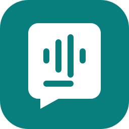
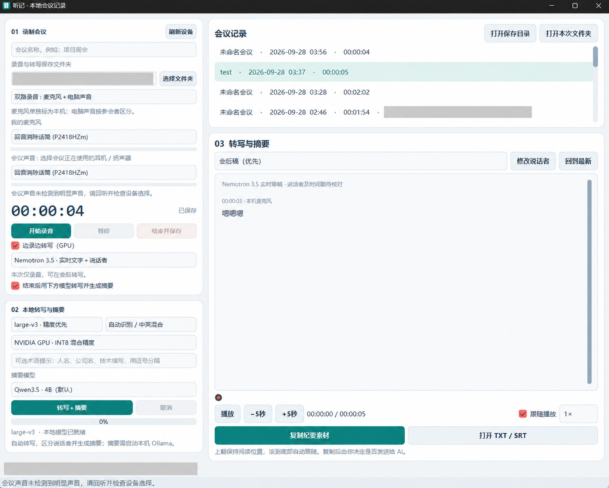

# 听记 · 本地会议记录

<p align="center"></p>
<p align="center"><strong>听会议，记重点。</strong><br>录音、实时转写、说话者区分、会后摘要、选中文本翻译，都在自己的电脑上完成。</p>

听记是一款 Windows 桌面会议记录工具。不需要机器人加入会议，也不依赖某一家会议软件的录音接口：通过 Windows 音频设备，记录电脑播放的声音和你的麦克风声音。

## 界面展示



*界面截图经 AI 图像编辑脱敏：已遮盖本机保存路径、用户名及会议主题，仅用于界面展示。*

## 为什么用听记

- **同时记录电脑与麦克风**：双路保存会议声音和自己的发言；也可选择仅录麦克风，适合麦克风已经收到了外放会议声音的场景。
- **无需机器人参会**：不需要邀请录音机器人，不增加会议参与者。
- **不限特定会议软件**：按音频设备采集，适用于会议客户端、浏览器会议、网课、访谈和本地播放内容。实际可采集范围取决于 Windows 和设备权限，并非逐个平台认证。
- **会议期间实时转文字、区分说话者**：使用 Nemotron 3.5 ASR 与 Nemotron 分离模型，显示参会者编号，方便边开会边回看。说话者编号和文字均可出错，需要核对。
- **会后自动整理，也可分别重做**：默认在结束录音后自动转写、标注说话者并生成摘要。手动“转写”只重新转写并区分说话者，“摘要”使用已有文字单独生成会议主题、要点、决定与待办；没有转写文字时摘要按钮禁用。
- **选中英文即可翻译**：在转写与摘要区选中文字，右键“翻译为中文”，旁边浮窗显示中文译文，可复制或关闭。轻量离线模型在 CPU 上运行，无需 Ollama。
- **回听和原文对应**：内置播放、拖动跳转、倍速、点击句子定位，以及播放到对应句子的高亮；向上翻看不会被新文字打断。
- **本地部署，开源免费**：项目代码采用 [MIT 许可证](LICENSE)，无订阅费、无按分钟收费，也不需要付费云端 API。硬件、电力及第三方模型许可条件仍由使用者自行承担。
- **数据留在自己手中**：音频和文字在本机处理，程序没有云端转写或摘要回退。模型安装完成后可离线使用；摘要仅连接本机 Ollama。

## 推荐配置

以下是本项目的使用建议，不是所有电脑均已验证的最低门槛。显存占用还受模型量化、上下文长度、会议软件和其他 GPU 程序影响。

| 使用方式 | 建议配置 | 说明 |
|---|---|---|
| 只录音、回听 | Windows 64 位、普通双核以上 CPU、8GB 内存、足够磁盘空间；不要求独显 | 无需加载 AI 模型。此配置为建议，未对所有低端设备做兼容性测试 |
| 实时转写＋会后转写＋4B 摘要 | Windows 11 64 位、现代四核以上 CPU、16GB 以上内存（推荐 32GB）、NVIDIA 8GB 显存、SSD | 本机 RTX 4060 Ti 8GB 已验证上述流程；推荐从 Qwen3.5:4B 开始 |
| 9B 摘要或更充裕的并行使用空间 | 推荐 32GB 内存、NVIDIA 12GB 以上显存、SSD | 这是余量建议；8GB 显卡也可能借助系统内存运行 9B，但通常更慢，不保证完全驻留显存 |

完整 AI 环境建议先预留 **50GB 可用 SSD 空间**，另留录音空间；仅录音可跳过模型下载。48kHz PCM16 单声道下，双路原声加混合回听文件约 **1.04GB/小时**，仅麦克风约 **0.35GB/小时**。实际大小随采样率变化。

本机验证结果和适用边界见 [VALIDATION.md](VALIDATION.md)。首次模型加载可能较慢；实时显示不是零延迟，短应答、口音、中英混合和重叠讲话仍需核对。

### 配置较低？可以只保留录音

在录制区取消勾选以下两项：

1. **边录边转写（GPU）**。
2. **结束后用下方模型转写并生成摘要**（新设置默认勾选，低配置使用时请手动取消）。

然后正常开始、暂停、结束并保存录音即可；不点击“转写”或“摘要”，程序就不会启动语音模型、说话者模型或摘要模型。录音与回听不要求 NVIDIA 显卡，也不要求运行 Ollama。以后可以在配置更好的电脑上处理保存的音频。

会后语音转写和分离支持 CPU 模式，但处理较慢；**当前实时引擎需要 NVIDIA GPU**。没有独显时建议先使用仅录音模式。

## 安装与启动

当前是源码运行的 Windows 桌面程序，并非下载即用的独立 EXE。完整 AI 功能需要分别准备以下组件：

| 组件 | 用途 | 安装情况 |
|---|---|---|
| Python 3.13 64 位、项目依赖 | 界面、录音、回听、Whisper 转写 | `Setup.cmd` 创建运行环境并安装依赖 |
| faster-whisper large-v3 / Turbo | 会后转写，可在界面选择 | `Setup.cmd` 下载；Turbo 已从实时选项移除 |
| 独立 Python 3.12、PyTorch / Transformers、Nemotron 模型 | 实时文字＋说话者、会后说话者分离 | **Setup.cmd 尚不自动安装**，需按 [Nemotron 环境说明](NEMOTRON_TRIAL.md) 单独配置 |
| [Ollama](https://ollama.com/download/windows)、Qwen3.5:4B 或 9B | 本地摘要 | 单独安装和下载 |
| OPUS-MT 英中模型、CTranslate2、SentencePiece | 选中文本离线翻译，CPU INT8 推理 | `Setup.cmd` 安装依赖并下载固定版本模型；无需 Ollama |

### 完整使用

1. 安装 Python 3.13（64 位），运行 `Setup.cmd`。首次安装需要联网下载依赖、Whisper 和 OPUS-MT 翻译模型。
2. 配置 Nemotron 独立环境及模型，详见 [NEMOTRON_TRIAL.md](NEMOTRON_TRIAL.md)。当前会后按钮会自动串联说话者区分，因此需要该组件。
3. 安装并启动 Ollama，下载摘要模型：

   ```powershell
   ollama pull qwen3.5:4b
   # 可选：较大的摘要模型
   ollama pull qwen3.5:9b
   ```

4. 双击 `Start.cmd` 启动。升级后关闭旧窗口再打开新版。`local_paths.json` 和 `runtime-path.txt` 为本机配置，换电脑需要重新安装配置。

### 仅录音安装：不下载 AI 模型

如果只需要录音，可以在项目目录执行以下命令，跳过 `Setup.cmd` 的模型下载步骤：

```powershell
py -3.13 -m venv .venv
.\.venv\Scripts\python.exe -m pip install -r requirements-lock.txt
.\.venv\Scripts\python.exe configure_local.py
```

这仍安装项目当前统一依赖，含一些 AI 运行库，但不会下载模型权重。随后打开 `Start.cmd`，取消上述两个 AI 开关；无需安装 Nemotron 环境或 Ollama。

## 日常使用

1. 输入会议名称，选择录音保存文件夹。
2. 选择录音模式：
   - **双路录音 · 麦克风＋电脑声音**：选择自己的麦克风，以及会议正在使用的耳机 / 扬声器。麦克风轨标为本机，电脑声音按参会者编号。
   - **仅录麦克风 · 含外放会议声音**：只保存麦克风收到的混合声音，所有人统一按参会者编号，不推断谁是本机本人。
3. 按需开启“边录边转写”，点击“开始录音”。建议首次做一分钟对话测试，确认实际声音能被录到。
4. 结束录音后，启用自动整理时，程序依次运行转写、分离和摘要；也可稍后选中会议，分别点击“转写”或“摘要”。摘要优先使用当前选中的文字稿；在摘要视图中重做摘要时，优先使用说话者标注稿。4B 是默认摘要模型，9B 可选。
5. 在右侧 03 下拉框切换“会后稿（说话者标注）”、“实时草稿”和“会后摘要”；默认显示带说话者标注的会后稿。标注尚未生成时，显示已有会后转写内容。会议列表显示名称、日期、时长及会议主题。
6. 使用正文下方播放器核对原声，或复制 / 导出结果。自动标签可以通过“修改说话者”校正。
7. 需要看中文时，在正文中选中一段英文，右键“翻译为中文”；译文显示在右键位置旁边的浮窗中，不覆盖原文，也不阻挡继续阅读。

暂停期间不保存声音，录音时间轴也不计入暂停时间。停止实时预览不会停止录音；AI 失败或取消时，原声和已完成的稿件仍保留。向上翻阅时保持阅读位置，点击“回到最新”恢复跟随。

**音频设备建议**：优先使用耳机或有回音消除能力的配套设备。程序不内置声学回声消除；普通扬声器外放可能被麦克风重复收录。仅麦克风模式可以避免两路重复混合，但不能恢复麦克风未录到或被回音消除过滤的声音。采集的是所选输出设备的全部声音，其他软件提示音也可能录入。

### 离线英中翻译

右键翻译使用 [Helsinki-NLP OPUS-MT 英中模型](https://huggingface.co/Helsinki-NLP/opus-mt-en-zh) 的 [CTranslate2 转换版本](https://huggingface.co/gaudi/opus-mt-en-zh-ctranslate2)，固定模型版本由 `meeting_scribe/translation.py` 指定。采用 CPU INT8 推理，不调用 Qwen，不要求独显或 Ollama，也不连接云端翻译服务。

- 浮窗只显示译文，支持复制、关闭；原文和已有稿件保持不变。
- 首次翻译加载模型，后续翻译复用同一个后台进程，减少反复加载的等待。
- 单次最多 6000 个字符；按段落和句子处理，长句进一步分段。专业术语、人名及复杂长句仍需对照原文核对。
- 模型约 160 MB，保存在项目的 `models/opus-mt-en-zh/`，由 Git 忽略。仅安装阶段联网；翻译期间只读取本机权重，缺少模型会提示安装，不自动下载或回退到其他服务。

新安装运行 `Setup.cmd` 即会安装翻译依赖和模型。已有安装升级后，在项目目录执行以下命令，再关闭旧窗口并重新启动：

```powershell
$runtimePython = (Get-Content .\local_paths.json -Raw | ConvertFrom-Json).python
& $runtimePython -m pip install -r requirements-lock.txt
& $runtimePython download_translation.py
```

## 隐私与本地文件

**本地处理减少了将会议内容发送给第三方的风险，但不等于“零隐私风险”。**

- 程序不主动上传会议音频或文字；语音推理使用本地模型，摘要请求只发送到 `127.0.0.1:11434`，不使用系统代理、不回退云端。
- 首次安装依赖、下载模型需要联网，不会因此上传录音。完整环境准备后，会议处理可离线进行。
- 录音和稿件为普通本地文件，**没有内置加密**；其他有权限的本机软件或用户可能读取。
- 保存到 OneDrive 等同步文件夹时，文件可能由云盘客户端上传。复制文字后，剪贴板历史、跨设备同步或手动粘贴到云端服务也可能传出内容。
- 程序不会自动开机录音或后台监听；录制前请确认符合会议参与者的约定。

默认数据根目录为 `%USERPROFILE%\MeetingScribeData`。左侧可更改录音目录；旧录音仍留在原位置并可继续列出。模型目录不随录音目录移动。

| 文件 / 目录 | 内容 |
|---|---|
| `microphone.wav` | 麦克风原声；仅麦克风模式下包含拾取到的全部发言 |
| `system.wav` | 双路模式中的电脑声音 |
| `mixed.wav` | 双路模式的混合回听文件；仅麦克风模式不生成 |
| `session.json` | 名称、日期、时长、设备、录制模式与状态 |
| `live_transcripts/`、`transcripts/` | 实时草稿、会后转写的历史版本 |
| `speaker_transcripts/` | 说话者标注稿及发言时间区间 |
| 各稿件下的 `summaries/` | 本地摘要、主题及模型信息 |
| `transcript.txt / .md / .srt / .json` | 文字、字幕与结构化时间戳 |
| `latest_*.json`、`live_*.json` | 最新版本指针和处理中间状态 |

重转写、重生成摘要会保存新版本，不覆盖旧稿。项目 Git 忽略规则排除了录音、模型、转写正文、摘要目录和本机路径配置。

## 模型与已知限制

- 实时：官方 [Nemotron 3.5 ASR](https://huggingface.co/nvidia/nemotron-3.5-asr-streaming-0.6b) ＋ [Nemotron 3 Diarization](https://huggingface.co/nvidia/Nemotron-3-Diarization)。使用流式时间匹配；不是把每位参会者音频独立分离出来。
- 会后转写：faster-whisper 的 large-v3 / Turbo；词时间戳与说话者区间匹配，跨人片段通过上下文复核时间。自动编号可能合并或变化，不代表真实姓名。
- 摘要：[Ollama Qwen3.5](https://ollama.com/library/qwen3.5) 4B / 9B。长稿分段归纳；摘要不能修复转写错误。时间戳检查只核对引用位置存在，不能证明结论事实正确。
- 长稿分段仅提取精简事实，输出触顶时自动精简重试一次。默认每次摘要都重新计算全部分段、中间合并和最终纪要，不读取旧缓存；完成后显示处理耗时并保留旧摘要版本。完整分段仍保存到本地 `summary_work/`，仅命令行显式传入 `--reuse-cache` 时复用。缓存含会议文字，由 Git 忽略；截断输出不会保存为完整摘要。
- 最近约 5 秒的实时已分段标签允许修订，较早标签固定。积压过大时 Nemotron 实时预览会停止，原声继续保存，可会后重转。
- 录音或暂停时可通过音源下拉框更换麦克风和会议声音设备，也可刷新设备列表；新设备成功打开后接替旧设备，同一会议继续保存。切换时可能有短暂空白，会议软件的输出设备需另行选择；已断连导致自动保存的录音仍需重新开始。单次录音上限 8 小时；异常退出会尝试恢复已落盘 WAV，但不能保证尾部零丢失。
- 安装与实时部分依赖独立环境及特定开发版本；尚未提供完整的一键 AI 安装器。低端设备、所有会议客户端及数小时多人会议没有全面兼容性或准确率保证。

## 开发与许可证

```powershell
python -m unittest discover -s tests
```

当前 86 项单元测试通过；此前还完成了本机录音链路、GPU 合成语音转写、说话者分离和本地 Ollama 摘要集成验证。设备热切换使用模拟设备验证，尚未完成实机测试；后台处理与录音并行尚未完成长时间实机验证。详情见 [验证记录](VALIDATION.md)。`scripts/` 中部分集成检查需要本机硬件、已安装模型和先前生成的合成测试素材；不包含用户会议文件。

项目代码采用 [MIT License](LICENSE)。第三方库与模型权重遵循各自许可证，本项目的 MIT 许可证不替代其许可条件。

### 连续会议与后台处理（2026-10-02）
- 会后转写、说话者区分、摘要串行处理，期间可开始、暂停、结束下一场录音。
- 后台有模型任务时，新会议自动只录音，避免与实时识别争用 GPU；录音结束后按自动处理选项排队。
- 会议列表显示旋转圆弧和处理阶段，排队会议显示“等待处理”。后台结果不会切换当前会议或覆盖正在录音的预览。
- 待处理队列保存到本机数据目录的 `processing_queue.json`；重开程序继续等待中的任务，异常中断的任务显示需手动重试。
- 实时识别在模型加载后有 90 秒追赶期；之后积压超过 30 秒且持续 30 秒未改善才退出。退出或空稿明确提示未完成。
- 摘要分段期间复用 Ollama 模型，整个任务结束或取消时请求释放显存。已有音频及转写版本保留。

### 无声提醒（2026-10-10）
- 仅检查录音开始阶段：双路模式的会议声音（扬声器／耳机）从开始录音起一直未检测到明显声音，满 30 秒时显示红色提示和非阻塞弹窗；仅录麦克风模式检查麦克风。录音继续保存。
- 每场最多提醒一次，暂停时间不计入。一旦监测音轨收到过声音，本场后续长时间安静也不再提醒；更换设备不重新开启检查。检测沿用峰值大于 0.001 的阈值，用于发现开场无声，不判断是否有人讲话。
